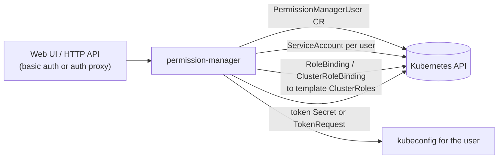

# Permission Manager

**User-friendly RBAC management for Kubernetes.** Create users, give them
namespaces and permission templates, and hand out ready-to-use kubeconfig files
from a web UI, without writing a single RoleBinding by hand.

This is a maintained fork of
[sighupio/permission-manager](https://github.com/sighupio/permission-manager)
with the open upstream issues and pull requests worked through (see
[Upstream issues and PRs](reference/upstream-backlog.md)).

-   :material-rocket-launch: **[Install](getting-started/install.md)**

    Helm chart (OCI) or plain manifests, Kubernetes 1.24 and newer.

-   :material-account-key: **[Users and kubeconfigs](usage/users.md)**

    Create a user, pick templates per namespace, download the kubeconfig.

-   :material-shield-lock: **[Kubeconfig tokens](configuration/kubeconfig-tokens.md)**

    Non-expiring token Secrets or time-bound tokens from the TokenRequest API.

-   :material-api: **[HTTP API](usage/api.md)**

    Script user creation from CI or GitOps instead of clicking through the UI.

{ loading=lazy }

## How it works

- A **user** is a `PermissionManagerUser` custom resource (cluster scoped) plus
  a ServiceAccount with the same name in the permission-manager namespace.
- A **template** is a ClusterRole named `template-namespaced-resources___<name>`.
  Giving a user a template in a namespace creates a RoleBinding to that
  ClusterRole; giving it in *all namespaces* creates a ClusterRoleBinding.
- **Cluster access** (none / read / write) binds the
  `template-cluster-resources___read-only` or `___admin` ClusterRole.
- The **kubeconfig** authenticates as the user's ServiceAccount.

## What changed compared to upstream v1.9.0

- Kubeconfig generation works on Kubernetes 1.24+ and fails loudly instead of
  returning a kubeconfig with an empty token.
- Optional time-bound tokens (`tokenrequest` mode).
- Deleting a user also deletes its ServiceAccount, so its kubeconfigs stop working.
- Basic auth can be disabled explicitly for deployments behind an authenticating proxy,
  and the username is configurable.
- Generated bindings can also include `User` / `Group` subjects.
- Request validation on the API: subject kinds, role kinds, usernames.
- Helm chart: `existingSecret`, Secret annotations, correct `appVersion`,
  OCI publishing with Artifact Hub metadata.
- UI: read/write access shown correctly for templates using `get`/`list`/`watch`
  and other explicit verbs.
- Unit tests for the Go server and the web-client in GitHub Actions.
